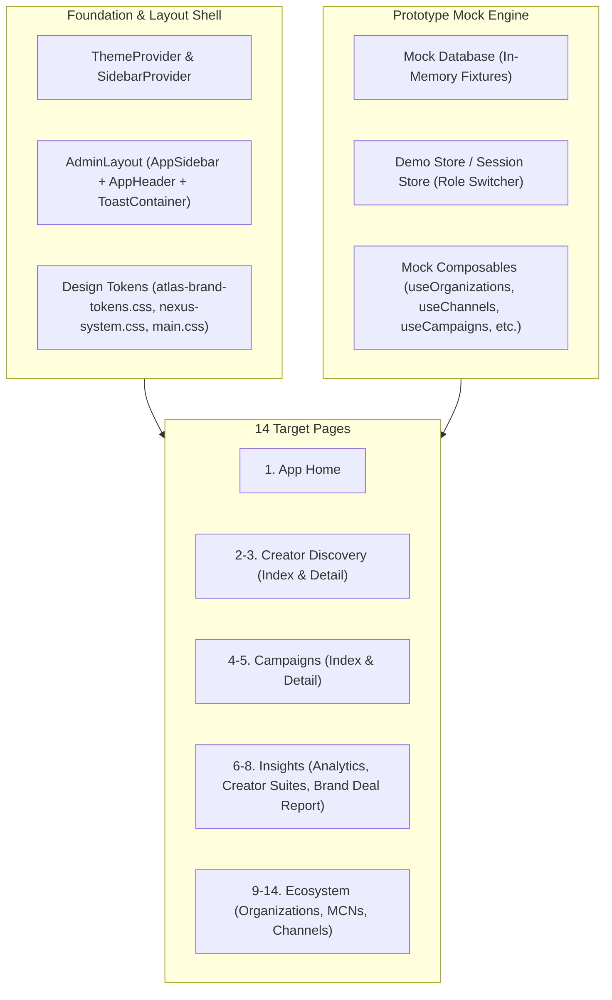

# Rencana Implementasi: Replikasi UI/UX Existing atlas-platform-fe ke atlas-nexus-prototype

Dokumen ini memuat rencana kerja terstruktur, bertahap, dan berkelanjutan untuk mengimplementasikan UI/UX existing dari `atlas-platform-fe` ke dalam prototype `atlas-nexus-prototype` pada **14 halaman target**.

---

## 1. Goal Description

Tujuan utama dari pekerjaan ini adalah mentransformasi `atlas-nexus-prototype` dari tampilan demo sederhana menjadi prototype dengan **tampilan, rasa (look and feel), tata letak (layout), komponen interaktif, dan navigasi yang 100% identik dengan aplikasi produksi (`atlas-platform-fe`)**, dengan karakteristik:
1. **Fully Standalone Client-side Demo**: Menggunakan lapisan **dummy data terpadu** (in-memory & reactive) tanpa dependensi ke backend server port 8000.
2. **Exact Route Matching**: Menyediakan 14 URL persis sesuai daftar spesifikasi pengguna, termasuk penanganan fallback UUID spesifik.
3. **High-Fidelity UI**: Membawa sistem desain asli (`AdminLayout`, `AppSidebar`, `AppHeader`, token warna, font `Outfit`, Lucide icons, card metric, tab interaktif, filter drawer, chart ApexCharts, dan modal).

```
┌──────────────────────────────────────────────────────────┐
│                   Atlas Platform FE                      │
│             (Production UI/UX Reference)                 │
└────────────────────────────┬─────────────────────────────┘
                             │  Porting UI/UX & Styling
                             ▼
┌──────────────────────────────────────────────────────────┐
│                 atlas-nexus-prototype                    │
│  ┌────────────────────────────────────────────────────┐  │
│  │ 14 Pages with Exact Layout & Components           │  │
│  └────────────────────────┬───────────────────────────┘  │
│                           │                              │
│  ┌────────────────────────▼───────────────────────────┐  │
│  │ Local Mock Engine / Reactive Dummy Store           │  │
│  │ (Zero backend dependency, persistent in browser)   │  │
│  └────────────────────────────────────────────────────┘  │
└──────────────────────────────────────────────────────────┘
```

---

## 2. 14 Target Pages & Mapping Reference

| No | Modul | Halaman Target | URL Atlas Nexus | File Path Sumber (`atlas-platform-fe`) | Target File (`atlas-nexus-prototype`) |
|---|---|---|---|---|---|
| **1** | **Workspace** | App Home | `/app/home` | `pages/app/home.vue` | `pages/app/home.vue` |
| **2** | **Campaign** | Creator Discovery Index | `/app/youtube-brand-campaign/creator-discovery` | `pages/app/youtube-brand-campaign/creator-discovery/index.vue` | `pages/app/youtube-brand-campaign/creator-discovery/index.vue` |
| **3** | **Campaign** | Creator Discovery Detail | `/app/youtube-brand-campaign/creator-discovery/edb25ae3-624f-48fe-9876-e26c3ec145ba` | `pages/app/youtube-brand-campaign/creator-discovery/[id].vue` | `pages/app/youtube-brand-campaign/creator-discovery/[id].vue` |
| **4** | **Campaign** | Creator Campaigns Index | `/app/youtube-brand-campaign/campaigns` | `pages/app/youtube-brand-campaign/campaigns/index.vue` | `pages/app/youtube-brand-campaign/campaigns/index.vue` |
| **5** | **Campaign** | Creator Campaigns Detail | `/app/youtube-brand-campaign/campaigns/6c641436-f41f-4c5d-8300-9b47b5774c2a` | `pages/app/youtube-brand-campaign/campaigns/[id].vue` | `pages/app/youtube-brand-campaign/campaigns/[id].vue` |
| **6** | **Insights** | Insight Analytics | `/app/analytics` | `pages/app/analytics/index.vue` | `pages/app/analytics/index.vue` |
| **7** | **Insights** | Creator Suites Index | `/app/creator-suites` | `pages/app/creator-suites/index.vue` | `pages/app/creator-suites/index.vue` |
| **8** | **Insights** | Brand Deals Report Detail | `/app/creator-suites/youtube-brand-deal-report/97aa8682-c826-4acd-a738-643ffc0bd060?tab=overview` | `pages/app/creator-suites/youtube-brand-deal-report/[id].vue` | `pages/app/creator-suites/youtube-brand-deal-report/[id].vue` |
| **9** | **Ecosystem** | Organization Index | `/app/organizations` | `pages/app/organizations/index.vue` | `pages/app/organizations/index.vue` |
| **10** | **Ecosystem** | Organization Detail | `/app/organizations/a3ce0027-3a9a-4acf-9dac-2c2cbff845cd` | `pages/app/organizations/[id].vue` | `pages/app/organizations/[id].vue` |
| **11** | **Ecosystem** | Partner Network Index | `/app/mcns` | `pages/app/mcns/index.vue` | `pages/app/mcns/index.vue` |
| **12** | **Ecosystem** | Partner Network Detail | `/app/mcns/c6c43b07-6abc-4ce1-8813-6d5e91f03d61` | `pages/app/mcns/[id].vue` | `pages/app/mcns/[id].vue` |
| **13** | **Ecosystem** | Channel Index | `/app/channels` | `pages/app/channels/index.vue` | `pages/app/channels/index.vue` |
| **14** | **Ecosystem** | Channel Detail | `/app/channels/d98a2e8b-63ff-44a7-99a5-9e59afcf57f4` | `pages/app/channels/[id].vue` | `pages/app/channels/[id].vue` |

---

## 3. User Review Required

> [!IMPORTANT]
> **Data Dummy Mandiri (Zero Backend Dependency)**
> Sesuai arahan Anda, prototipe ini tidak memerlukan koneksi ke backend riil. Kami akan menyediakan dummy state generator komprehensif yang siap mengisi seluruh tabel, metrik grafis, kartu kreator, dan data detail untuk setiap UUID spesifik yang diakses.

> [!NOTE]
> **Paket Dependensi Tambahan yang Diperlukan**
> Agar komponen UI existing dari `atlas-platform-fe` berjalan tanpa galat di `atlas-nexus-prototype`, kita perlu menginstal pustaka utama yang digunakan pada UI fe:
> - `lucide-vue-next` (seluruh icon sidebar, header, tombol, tab, status)
> - `@vueuse/core` & `@vueuse/nuxt` (utilitas reaktifitas window, dark mode, clipboard)
> - `clsx` & `tailwind-merge` (manajemen class Tailwind)
> - `vue3-apexcharts` & `apexcharts` (grafik analytics & dashboard)

---

## 4. Arsitektur Teknis Prototype



---

## 5. Proposed Changes (To-Do List Bertahap)

Rencana eksekusi dibagi menjadi 5 fase berurutan agar dapat dijalankan dan diverifikasi satu per satu:

### Fase 0: Persiapan Fondasi & Design System
Menyiapkan pondasi umum agar seluruh komponen UI existing dapat me-render dengan sempurna.
- [x] **Dependencies**: Install `lucide-vue-next`, `@vueuse/core`, `@vueuse/nuxt`, `clsx`, `tailwind-merge`, `vue3-apexcharts`, `apexcharts`, `reka-ui`, `class-variance-authority`, `axios`.
- [x] **Dependencies (tambahan saat Fase 3)**: Install `vue-flatpickr-component@^11.0.5` + `flatpickr@^4.6.13`. Komponen tersalin `components/forms/DatePicker.vue` (dipakai `youtube-channel-report` dan `ContractFormModal`) mengimpor paket ini, dan `npm run build` gagal me-resolve-nya. Versi disamakan dengan `atlas-platform-fe` agar perilaku kalender identik; alternatif menulis ulang komponen dinilai lebih berisiko terhadap fidelitas.
- [x] **Config**: Perbarui `nuxt.config.ts` untuk mengaktifkan VueUse dan ApexCharts client-plugin.
- [x] **Styles**: Salin token CSS lengkap dari `atlas-platform-fe`:
  - `assets/css/atlas-brand-tokens.css`
  - `assets/css/nexus-system.css`
  - `assets/css/nexus-home.css`
  - `assets/css/main.css`
- [x] **Layout Shell**:
  - `components/layout/ThemeProvider.vue`
  - `components/layout/SidebarProvider.vue`
  - `components/layout/AdminLayout.vue`
  - `components/layout/AppSidebar.vue`
  - `components/layout/AppHeader.vue`
  - `components/layout/Backdrop.vue`
  - `components/ui/ToastContainer.vue`
  - `layouts/default.vue`
- [x] **Common UI Components**:
  - `components/common/Breadcrumb.vue`
  - `components/common/MetricValue.vue`
  - `components/common/StatusBadge.vue`
  - `components/common/EmptyState.vue`
  - `components/common/YoutubeIcon.vue`
  - `components/common/Tabs.vue`
  - `components/ui/DataTable.vue`
  - `components/ui/Modal.vue`
- [x] **Mock Engine & Dummy Fixture Store**:
  - Siapkan composables tiruan (`useOrganizations`, `useChannels`, `useMcns`, `useCampaigns`, `useCreatorDiscovery`, `useAnalytics`, `useCampaignReport`, `useAuthStore`, `useApi`) yang menyuplai data instan lokal.

---

### Fase 1: App Home (Item 1)
- [x] **Route**: `pages/app/home.vue`
- [x] Porting komponen dashboard:
  - `components/dashboard/NetworkWelcome.vue`
  - `components/dashboard/ControlTowerQuickActions.vue`
  - `components/dashboard/PlatformMetrics.vue`
  - `components/dashboard/TopChannelsTable.vue`
  - `components/dashboard/ChannelDistributionDonut.vue`
  - `components/dashboard/ActivityFeed.vue`
  - `components/dashboard/DashboardAttention.vue`
  - `components/dashboard/RecentItems.vue`
  - `components/dashboard/CreatorSuitesSummaryCard.vue`
  - `components/dashboard/SystemStatusFooter.vue`
  - `components/dashboard/OrgCommandCenter.vue`
  - `components/dashboard/McnOperationsView.vue`
- [x] Hubungkan dummy data agar Home langsung menampilkan metrik, tabel top channel, dan feed aktivitas.

---

### Fase 2: YouTube Brand Campaign Suite (Items 2, 3, 4, 5)
- [x] **Halaman 2 (Creator Discovery Index)**:
  - `pages/app/youtube-brand-campaign/creator-discovery/index.vue`
  - Implementasi search bar, filter chip kategori, toggle grid/tabel kreator, preview drawer, dan pagination.
- [x] **Halaman 3 (Creator Discovery Detail)**:
  - `pages/app/youtube-brand-campaign/creator-discovery/[id].vue`
  - Target UUID default: `edb25ae3-624f-48fe-9876-e26c3ec145ba` (dengan fallback otomatis ke profil kreator lengkap jika id apapun dimasukkan).
  - Profil channel YouTube, metrik views, estimasi rate card, video terbaru, dan audience snapshot.
- [x] **Halaman 4 (Campaigns Index)**:
  - `pages/app/youtube-brand-campaign/campaigns/index.vue`
  - Status tab (Draft, Active, Completed), draft stats bar, tabel kampanye brand, dan modal tombol aksi.
- [x] **Halaman 5 (Campaigns Detail)**:
  - `pages/app/youtube-brand-campaign/campaigns/[id].vue`
  - Target UUID default: `6c641436-f41f-4c5d-8300-9b47b5774c2a`.
  - Tab kampanye: Overview, Creators / Shortlist, Pipeline Aplikasi, Deliverables, Budget Forecasting.

---

### Fase 3: Insights & Creator Suites (Items 6, 7, 8) — SELESAI (19 Okt 2026)
- [x] **Halaman 6 (Insight Analytics)**:
  - `pages/app/analytics/index.vue`
  - Summary cards (Total Views, Estimated Revenue, Watch Time), filter rentang hari (7d, 14d, 30d), ApexCharts Timeseries, Top Channels Chart, Channel Performance Table.
  - Halaman & komponen (`components/analytics/*`, `composables/useAnalytics.ts`) identik byte-for-byte dengan `atlas-platform-fe`.
  - **Mock kontrak**: `useApi` kini melayani `/analytics/summary`, `/analytics/timeseries`, `/analytics/top-channels` (menghormati `sort_by=views|revenue`), `/analytics/revenue-by-mcn`, `/analytics/refresh`, plus drill-down `/analytics/channels/{id}` dan `/analytics/channels/{id}/top-videos` dengan bentuk respons persis seperti `useAnalytics.ts`. Dummy berisi 30 titik harian, 5 channel (2 MCN), dan 1 channel yang dikecualikan sehingga banner peringatan ikut terlihat.
  - **Housekeeping**: file demo lama `pages/app/analytics.vue` dihapus. File itu bertabrakan rute dengan `pages/app/analytics/index.vue` pada `/app/analytics` dan memenangkan tabrakan tersebut, sehingga halaman hasil porting sebelumnya tidak pernah bisa diakses.
- [x] **Halaman 7 (Insight Creator Suites Index)**:
  - `pages/app/creator-suites/index.vue`
  - Hero banner "See what your content delivers", katalog tool cards (YouTube Brand Deal Report, YouTube Channel Report, Channel Profiling).
  - **Mock kontrak**: cabang baru `GET /api/v1/tools` mengembalikan array tool (`slug`, `name`, `description`, `scope`, `status`, `video_url_limit`) sehingga katalog tampil; `GET /api/v1/dashboard/creator-suites-summary` mengembalikan `{ tools, recent_reports }` sehingga kartu "Recent reports" terisi. Sebelumnya jalur `/dashboard/creator-suites-summary` tertangkap cabang generik `/creator-suites` dan halaman hanya menampilkan empty state.
- [x] **Halaman 8 (Brand Deal Report Detail)**:
  - `pages/app/creator-suites/youtube-brand-deal-report/[id].vue`
  - Target UUID default: `97aa8682-c826-4acd-a738-643ffc0bd060` dengan query `?tab=overview`.
  - Komponen tabs: Overview, Videos, Channels, Comments, AI Insight summary.
  - **Mock kontrak**: `mockBrandDealReport.report_data` disesuaikan dengan tipe `ReportData` di `useCampaignReport.ts` — `videos[].content` (sebelumnya `content_details`) dengan `duration_formatted`, `snippet` lengkap (`tags`, `category_id`, `category_label`, `default_language`), `statistics.engagement_rate`, `topics`, `live_streaming`, serta `aggregates` lengkap. Tab **Videos** sebelumnya crash (`Cannot read properties of undefined (reading 'duration_formatted')`) dan tab **Comments** crash (`Cannot convert undefined or null to object`) karena `/comments/fetch-status` tertangkap cabang generik report. Sub-endpoint report sekarang diurutkan lebih dulu: `/comments/fetch-status`, `/comments/fetch`, `/comments`, `/insight`, `/share`, lalu rute report generik.
  - **AI Insight summary**: fixture lengkap `InsightData` (executive) disertakan, jadi tab Insight menampilkan ringkasan, KPI, key insights, top content, rekomendasi, dan client-ready summary. Lane `comments` sengaja dibiarkan kosong agar menampilkan state "generate" (bukan data salah tipe).

---

### Fase 4: Ecosystem Management (Items 9, 10, 11, 12, 13, 14) — BELUM DIMULAI
- [ ] **Halaman 9 & 10 (Organizations Index & Detail)**:
  - `pages/app/organizations/index.vue`: Filter search, tabel organisasi dengan jumlah channel, partner MCN, dan status.
  - `pages/app/organizations/[id].vue`: Target UUID `a3ce0027-3a9a-4acf-9dac-2c2cbff845cd`. Header organisasi, tab MCNs, Channels, Contracts, dan Team Members.
- [ ] **Halaman 11 & 12 (Partner Networks / MCNs Index & Detail)**:
  - `pages/app/mcns/index.vue`: Filter organisasi, daftar MCN partners, channel count.
  - `pages/app/mcns/[id].vue`: Target UUID `c6c43b07-6abc-4ce1-8813-6d5e91f03d61`. Detail MCN partner, channel terhubung, revenue split, dan kontrak.
- [ ] **Halaman 13 & 14 (Channels Index & Detail)**:
  - `pages/app/channels/index.vue`: Filter multi-level (Organization, MCN, Status), tabel YouTube channel dengan subscriber, views, dan action buttons.
  - `pages/app/channels/[id].vue`: Target UUID `d98a2e8b-63ff-44a7-99a5-9e59afcf57f4`. Detail channel YouTube, metadata video, histori sinkronisasi, dan status afiliasi.

---

## 6. Verification Plan

### Automated Verification
1. **Type & Build Check**:
   ```sh
   npm run build
   ```
   Memastikan tidak ada syntax error, missing import, atau unresolvable component.

2. **Route Smoke Test**:
   Memastikan seluruh 14 endpoint me-render status 200 tanpa error runtime:
   - `http://localhost:3000/app/home`
   - `http://localhost:3000/app/youtube-brand-campaign/creator-discovery`
   - `http://localhost:3000/app/youtube-brand-campaign/creator-discovery/edb25ae3-624f-48fe-9876-e26c3ec145ba`
   - `http://localhost:3000/app/youtube-brand-campaign/campaigns`
   - `http://localhost:3000/app/youtube-brand-campaign/campaigns/6c641436-f41f-4c5d-8300-9b47b5774c2a`
   - `http://localhost:3000/app/analytics`
   - `http://localhost:3000/app/creator-suites`
   - `http://localhost:3000/app/creator-suites/youtube-brand-deal-report/97aa8682-c826-4acd-a738-643ffc0bd060?tab=overview`
   - `http://localhost:3000/app/organizations`
   - `http://localhost:3000/app/organizations/a3ce0027-3a9a-4acf-9dac-2c2cbff845cd`
   - `http://localhost:3000/app/mcns`
   - `http://localhost:3000/app/mcns/c6c43b07-6abc-4ce1-8813-6d5e91f03d61`
   - `http://localhost:3000/app/channels`
   - `http://localhost:3000/app/channels/d98a2e8b-63ff-44a7-99a5-9e59afcf57f4`

### Manual Verification
1. **Visual Fidelity Inspection**: Membandingkan layout, icon, warna tombol, spasi, dan tabel dengan referensi asli `atlas-platform-fe`.
2. **Interactive States**:
   - Navigasi sidebar berpindah dengan mulus antar halaman.
   - Tab-switching (Overview, Videos, Comments, dsb) di halaman detail berfungsi responsif.
   - Fitur filter & search dapat memfilter item dummy tanpa crash.
   - Chart analytics me-render grafik interaktif.

---

## 7. Status Verifikasi (19 Okt 2026)

Semua angka di bawah berasal dari eksekusi nyata pada build produksi (`.output/server/index.mjs`) yang diserve di `http://127.0.0.1:3100`, diuji dengan headless Google Chrome lewat CDP: setiap route di-load, lalu exception runtime + `console.error` + `Log.entryAdded` dikumpulkan. Route dinyatakan LULUS hanya jika tidak ada error dan konten ter-render.

### 7.1 Hasil otomatis

| Pemeriksaan | Perintah | Hasil |
|---|---|---|
| Build | `GEMINI_API_KEY= npm run build` | ✅ `Build complete!` (2135 modul) |
| Unit test | `npm run test:unit` | ✅ 14/14 lulus |
| Route smoke Fase 3 | 3 route + 7 tab | ✅ 10/10 lulus |

### 7.2 Fase 3 — lulus penuh

| Route / tab | Status | Bukti (ringkas) |
|---|---|---|
| `/app/analytics` | ✅ | `TOTAL VIEWS 6.2M`, `WATCH TIME 184.5K hrs`, `SUBSCRIBERS +3,420`, `EST. REVENUE $12,450.00`; timeseries, Top 10 Channels, Est. Revenue by MCN, dan tabel Channel Performance terisi |
| `/app/creator-suites` | ✅ | Hero + 3 tool card (Brand Deal Report, Channel Report, Channel Profiling) + 3 Recent reports |
| `…/youtube-brand-deal-report/97aa8682-…?tab=overview` | ✅ | KPI 96.6K views, avg engagement 5.37%, avg views 48.3K, Top Videos by Views |
| `…?tab=videos` | ✅ | 2 baris video dengan durasi (12:25 / 1:00), kategori, eng. rate |
| `…?tab=channels` | ✅ | Channel + statistik + aggregate |
| `…?tab=comments` | ✅ | Run summary 2/2 video, 3 komentar, tabel komentar + reply |
| `…?tab=insight` | ✅ | Executive Insight lengkap (health, KPI, key insights, rekomendasi, client-ready summary) |
| `…?tab=setup` | ✅ | Form setup + limit 50 URL video |
| `…?tab=share` | ✅ | Status share + public URL |
| `/app/analytics/channels/UC_dr_kevin_mak` | ✅ | Drill-down channel |

### 7.3 Temuan di luar Fase 3 (perlu tindak lanjut)

Route smoke seluruh 14 halaman menemukan bahwa **Fase 1 dan Fase 2 saat ini gagal render di runtime**, meski checklist-nya sudah ditandai selesai. Ini bukan akibat pekerjaan Fase 3 (Fase 3 hanya menambah cabang endpoint baru + memperbaiki bentuk fixture report/analytics); penyebabnya adalah cabang mock yang belum lengkap pada `composables/useApi.ts`.

| Route | Status | Gejala |
|---|---|---|
| `/app/home` | ❌ | Blank (26 karakter ter-render). `TypeError: Cannot read properties of undefined (reading 'pending_verifications')` |
| `/app/youtube-brand-campaign/creator-discovery` | ❌ | `TypeError: … .slice is not a function`, `… .filter is not a function` |
| `/app/youtube-brand-campaign/creator-discovery/edb25ae3-…` | ❌ | `TypeError: Cannot read properties of undefined (reading 'length')` |
| `/app/youtube-brand-campaign/campaigns` | ❌ | Blank (31 karakter). `TypeError: … (reading 'percentage')` |
| `/app/youtube-brand-campaign/campaigns/6c641436-…` | ❌ | Error runtime saat inisialisasi |
| `/app/organizations` | ⚠️ | Render, tetapi masih memakai halaman demo lama (`pages/app/organizations.vue` + `stores/demo`), belum halaman hasil porting |
| `/app/mcns` | ⚠️ | Sama seperti di atas (`pages/app/mcns.vue`) |
| `/app/channels` | ⚠️ | Sama seperti di atas (`pages/app/channels.vue`) |
| `/app/organizations/a3ce0027-…` | ❌ | `Page not found` — Fase 4 belum dikerjakan |
| `/app/mcns/c6c43b07-…` | ❌ | `Page not found` — Fase 4 belum dikerjakan |
| `/app/channels/d98a2e8b-…` | ❌ | `Page not found` — Fase 4 belum dikerjakan |

**Akar masalah Fase 1:** `composables/usePlatformOverview.ts` memanggil `/api/v1/dashboard/platform-overview`, sedangkan mock hanya mencocokkan `/overview/platform` dan `/overview/control-tower`. Request jatuh ke fallback `{ success: true }`, sehingga `counts` menjadi `undefined` dan `components/dashboard/DashboardAttention.vue` / `PlatformMetrics.vue` melempar error saat render.

**Akar masalah Fase 2:** bentuk respons mock untuk creator bank dan campaign belum mengikuti kontrak komposit di `composables/youtubeBrandCampaign/*` (mis. daftar yang diharapkan array tetapi menerima objek, dan metrik distribusi tanpa `percentage`).

**Sudah siap untuk Fase 4:** `mocks/mockData.ts` sudah memuat `TARGET_IDS` untuk organisasi/MCN/channel beserta fixture `mockOrganizations`, `mockMcns`, `mockChannels`, dan `composables/useApi.ts` sudah melayani `/organizations`, `/mcns`, `/channels` (list maupun detail dengan relasi `mcns`/`channels`/`recent_videos`). Yang belum ada hanyalah halaman `pages/app/**/[id].vue` yang menjadi target Fase 4.

### 7.4 Catatan lingkungan

- `tests/e2e/` masih kosong; `npm run test:e2e` tidak menemukan file. Route smoke di atas dijalankan dengan skrip CDP sementara (tanpa dependensi npm baru) dan hasilnya dicatat di sini.
- Saat build muncul warning non-blocking: `Two component files resolving to the same name Shadcn*` (karena barrel `index.ts` di dalam `components/shadcn/*` ikut terbaca sebagai komponen) dan puluhan `Duplicated imports` antar composable report/channel report. Tidak memengaruhi hasil; kandidat pembersihan terpisah.
